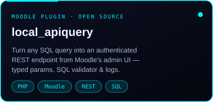
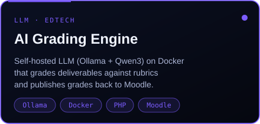
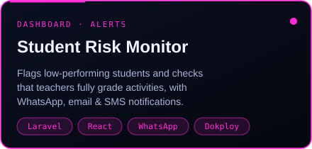
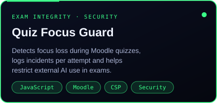

<div align="center">



<p>
  <a href="https://www.linkedin.com/in/cesar-machado-551346258/"></a>
  <a href="mailto:cesarmachado443@gmail.com"></a>
  
  
</p>



</div>


## ⚡ `> about.exe`

I'm a **Full-Stack Developer** from Colombia who builds, administers and secures **e-learning platforms** for universities and EdTech companies. I work across the whole stack — Moodle plugins and custom themes, Laravel + React apps, Docker deployments on Linux and security audits — and I specialise in bringing **AI into education** in a practical, safe way.

> 🇪🇸 *Desarrollador Full-Stack especializado en plataformas educativas (Moodle y Canvas LMS), integraciones con IA y ciberseguridad.*

<table>
<tr>
<td width="50%" valign="top">

**🎓 LMS engineering**<br/>
<sub>Moodle & Canvas LMS · plugins · themes · upgrades · Microsoft 365 OAuth2</sub>

**🤖 AI × Education**<br/>
<sub>Self-hosted LLMs (Ollama) · rubric-based automatic grading</sub>

**🧩 Full-stack apps**<br/>
<sub>Laravel APIs · React SPAs · dashboards · WhatsApp / email / SMS</sub>

</td>
<td width="50%" valign="top">

**🛡️ Security**<br/>
<sub>Penetration testing · web audits · LMS hardening · exam integrity</sub>

**🐳 DevOps**<br/>
<sub>Docker · Dokploy · Nginx · Linux VPS</sub>

**🌐 Languages**<br/>
<sub>Spanish (native) · English (intermediate, technical)</sub>

</td>
</tr>
</table>


## 🛠️ `> stack --list`

<p align="center">
  
</p>

<p align="center">
  
  
  
  
  
  
  
</p>


## 🚀 `> projects --featured`

<p align="center">
  <a href="https://github.com/cesarmachado443/moodle-local_apiquery"></a>
  
</p>
<p align="center">
  
  
</p>

<sub>Also built: a Git-inspired <b>syllabus versioning & approval system</b> (Laravel) and full <b>LMS redesigns</b> with custom Moodle theme plugins.</sub>


## 💼 `> experience --log`

```diff
+ 2025 → now   LMS & Full-Stack Developer (Contractor) · CUC University
+ 2024 → now   Full-Stack Developer · Universidad de la Costa (CUC)
+ 2024 → now   Freelance Full-Stack Developer · EdTech clients
! 2023 → 2024  Full-Stack Developer · Globalsoft T&S (.NET · SQL Server)
# 2023         Software Development Apprentice · Universidad de la Costa
```


## 📡 `> activity --live`

<p align="center">
  
</p>

<p align="center">
  
</p>


<div align="center">

### 📫 `> connect --now`

**Need a Moodle expert, an LMS integration, an AI grading workflow or a security review?**

<a href="mailto:cesarmachado443@gmail.com"></a>

</div>
